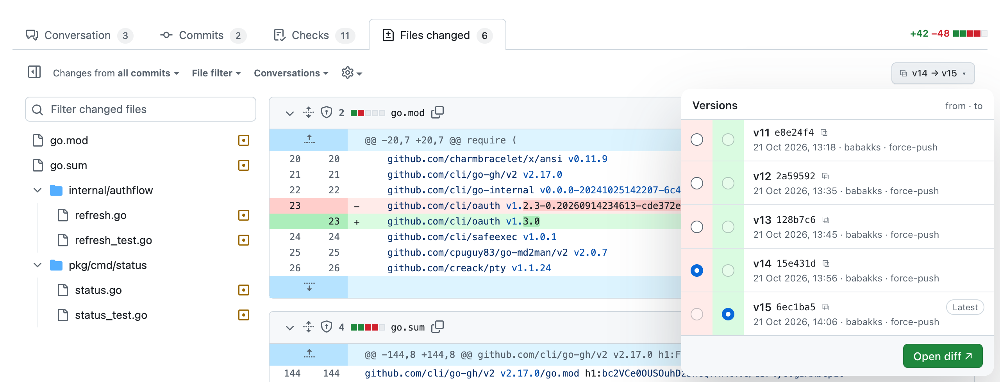

<h1 align="center">PR Versions for GitHub</h1>

  <strong>Every push</strong> is a version 
  <strong>Force-pushes</strong> don't erase history 
  On <strong>GitHub</strong> and <strong>Linear Diffs</strong>

  <a href="https://github.com/BartInTheField/github-version-diff/releases/latest">Install</a> ·
  <a href="docs/usage.md">Usage</a> ·
  <a href="docs/token.md">Token</a> ·
  <a href="https://github.com/BartInTheField/github-version-diff/issues/new">Issues</a>

PR Versions is a Chrome extension that adds a Graphite-style **version picker** to a pull request's **Files changed**
tab, and to the same PR in [Linear Diffs](https://linear.app/docs/diffs). Every push to the PR branch is a version,
including the states that force-pushes threw away. Pick any two and **Open diff ↗** shows exactly what changed between
them, in GitHub's own compare view.

> An agent or a colleague says "pushed the fix" after three force-pushes. You want to see only what changed since the
> version you reviewed. Open the picker: it already says **Your last review → latest**.

<picture>
  <source media="(prefers-color-scheme: dark)" srcset="docs/images/screenshot-dark.png">
  
</picture>

## Why PR Versions

- **One version per push, like Graphite.** v1 is the state the PR was opened with, and every push after it adds one.
  The numbers and SHAs match Graphite's picker.
- **Force-pushes keep their history.** GitHub's "Compare" link only covers one force-push. Here, any two versions can be
  compared, across as many amends and rebases as you like.
- **Picks up where you left off.** The default range starts at your last review, or the last version you opened, and the
  button shows how many versions are new.
- **Warns about rebases.** When a range crosses a rebase, the picker says so and lists the files that changed only on
  the base branch.
- **No setup.** It reads the pages you can already see, with your normal GitHub login. A
  [token](docs/token.md) is optional.
- **Looks native.** Primer colours on GitHub, so every GitHub theme works. Linear's own colours and font on Linear.

## Install

1. Download the latest `pr-versions_<version>.zip` from
   [Releases](https://github.com/BartInTheField/github-version-diff/releases/latest) and unzip it.
2. Open `chrome://extensions` and turn on **Developer mode**.
3. Click **Load unpacked** and pick the unzipped `pr-versions` folder.
4. Open any PR's **Files changed** tab. The picker is in the toolbar.

**To update:** unzip a newer release over the same folder, then click reload on the extension card.

## Usage

Click the picker button (`v3 → v5`, or **All changes**), choose a **from** and a **to** version, and click
**Open diff ↗**. In Linear, open a PR review: the picker sits bottom-left, and the diff opens on GitHub in a new tab.

## Docs

- [Usage](docs/usage.md): the version list, picking a range, the default range, the rebase warning, and Linear Diffs
- [GitHub token](docs/token.md): when you need one, and how to set it up
- [Known limitations](docs/limitations.md): what the extension can't do (yet)
- [Development](docs/development.md): building from source, the code map, releases
- [Testing](docs/testing.md): unit tests, fixtures, and the manual test checklist
- [Privacy](docs/privacy.md): what the extension stores and sends
- [Chrome Web Store](docs/chrome-web-store.md): publishing a release and the listing text

Found a bug or have an idea? [Open an issue](https://github.com/BartInTheField/github-version-diff/issues/new).

## License

[MIT](LICENSE)
